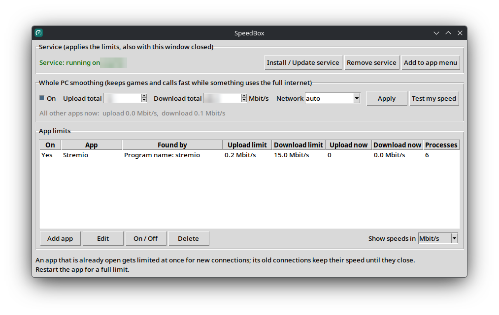
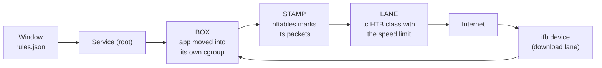

# SpeedBox

**Upload and download speed limits per app on Linux, plus whole-PC smoothing so games and calls stay fast while something else uses the full line.**


> **Tested on one PC only** (CachyOS, kernel 7.2, KDE). The service runs as root and changes the network setup (tc, nftables). Emergency undo: `sudo python3 speedboxd.py cleanup` (see [Troubleshooting](#troubleshooting)).



## What is SpeedBox?

A torrent-based app like Stremio keeps uploading even after a movie is downloaded. On a small upload line that fills the router's queue, and live apps (calls, online games, AI chat) lag or drop. SpeedBox gives each app its own upload and download limit, and keeps the whole PC just under the real line speed. **It limits apps by cgroup, the one handle the Linux network stack really has for a program, so an app can't escape by changing ports, and it is undone completely when the service stops.**

| Part | Runs as | Does |
|---|---|---|
| `speedbox.py` (window) | you | Edits the rules, shows live speeds. Asks the password only to install, update or remove the service |
| `speedboxd.py` (service) | root, via systemd | Applies the rules at boot and whenever they change, also with the window closed |

## Features

- **Per-app limits:** upload and download separately, in Mbit/s, KB/s or MB/s; 0 = no limit.
- **Find apps three ways:** program name, text in the command line, or Flatpak app ID; pick from running programs or the app menu.
- **Helpers included:** programs an app starts are limited too (Stremio's torrent engine is a separate `node` process).
- **Instant:** the kernel reports every program start, so a new app is limited before it connects.
- **Whole-PC smoothing:** keeps total traffic under your line speed; a built-in speed test suggests the numbers.
- **LAN stays fast:** traffic to your own network is never limited.
- **Torrent friendly:** tiny "got it" packets don't count against upload limits, so a low upload limit can't choke the download.
- **Self-healing:** if something resets the network setup, it is applied again within 5 seconds.
- **Clean undo:** stopping the service moves every app back and removes every change.

## How it works



The service watches the rules file and every program start. A matching app is moved into its own cgroup. nftables gives packets from that cgroup a mark, and tc sends marked packets into an HTB class with the app's limit (fq_codel keeps each queue short). Download traffic is redirected to an `ifb` device, where the connection's mark is restored and the same kind of class applies.

## Quick start

Requirements: Linux with systemd and cgroup v2, Python 3.6+ with tkinter, iproute2, nftables, polkit. The installer adds the missing packages.

```sh
git clone https://github.com/Muzasio/speed-box.git
cd speed-box
./install.sh
```

Then open **SpeedBox** from the app menu → **Test my speed** → **Add app**.

| The installer | Details |
|---|---|
| Installs system packages | Only the missing ones, with `pacman`, `apt-get`, `dnf` or `zypper` |
| Checks the PC | systemd, cgroup v2, Python 3.6+ with tkinter |
| Adds the menu entry | `~/.local/share/applications/speedbox.desktop` |
| Installs the service | Root service under systemd, starts now and at every boot |

Options: `--no-service`, `--uninstall` (keeps your rules), `--uninstall --purge` (also deletes them).

### Check your PC (optional)

The installer checks these too. Run inside any folder:

```sh
python3 -c "import tkinter; print('tkinter', tkinter.TkVersion)"   # tkinter 8.6
stat -fc %T /sys/fs/cgroup                                          # cgroup2fs
tc -V; nft --version; pkexec --version                              # one version line each
```

`cgroup2fs` is required: on old cgroups (`tmpfs`) SpeedBox can't work. The folder path may only hold letters, numbers, spaces and `_ @ . + / -`.

### Prove it works

1. In the window, click **Test my speed** (about 15 s), answer **Yes**. The smoothing boxes fill and **On** is ticked.
2. **Add app** → **Pick from app menu...** → pick an app that uses the internet → set download to `2` Mbit/s → **Save**.
3. Start the app and download something. Its row shows **Processes** above 0 and **Download now** at about `2.0 Mbit/s` or less.
4. Check the service: `systemctl is-active speedbox` prints `active`.

### Install without the installer

```sh
python3 speedbox.py --install-menu   # menu entry
python3 speedbox.py                  # then click "Install / Update service" (asks your password)
```

### Remove it

```sh
./install.sh --uninstall           # removes the service and the menu entry, keeps your rules
./install.sh --uninstall --purge   # also deletes your rules (~/.config/speedbox)
```

## Settings

Your rules are set in the window and saved in `~/.config/speedbox/rules.json`. Fixed program settings are in `settings.json`:

| Setting | Default | What it does |
|---|---|---|
| `loop_seconds` | `1` | How often the service checks the rules file |
| `scan_seconds` | `2` | Full scan of running programs and status update for the window |
| `check_seconds` | `5` | How often the network setup is checked and repaired |
| `retry_seconds` | `30` | Wait before trying a failed network setup again |
| `ifb_device` | `ifb-speedbox` | Name of the download lane device |
| `mark_base` | `23296` | First packet mark SpeedBox uses |
| `lan_unlimited` | `true` | Never limit traffic to your own network |
| `lan_ipv4`, `lan_ipv6` | private ranges | What counts as your own network |
| `small_packet_bytes` | `128` | Packets this small skip upload limits ("got it" packets) |
| `max_apps` | `200` | Most app rules allowed |
| `speedtest_*` | Cloudflare | Speed test addresses, size, and the share (85 %) suggested for smoothing |

After changing `settings.json`, click **Install / Update service** again.

## Known limits

- An app that was already open keeps its old connections at full speed until they close; restart it for a full limit.
- Torrent apps need some upload: keep it at 1 Mbit/s or more, or peers stop sending.
- One network device at a time; only your own user's apps.
- Limited apps' log lines appear under `journalctl -u speedbox`.


## Troubleshooting

| Problem | Fix |
|---|---|
| Internet broken or slow after a crash | `sudo python3 speedboxd.py cleanup` removes every SpeedBox network change |
| `Service: installed but not running` | `journalctl -u speedbox` shows why |
| An app is not limited yet | Restart the app; old connections keep full speed until they close |
| Torrent download stalls | Raise its upload limit to 1 Mbit/s or more |


## Status

**Tested:** CachyOS, kernel 7.2.7, Python 3.14.7, Tk 8.6, iproute2 7.2.0, nftables 1.1.7, systemd 262. tc and nftables setup, real speed limits, LAN exemption and the service logic in a sandbox; the real install with Stremio.

**Not tested yet**
- Other distros, a fresh install, Wi-Fi to cable switching
- A measured before / after with games or calls
- Flatpak and command-line match modes on real apps
- Crash and restart of the service

## License

[MIT](LICENSE)
